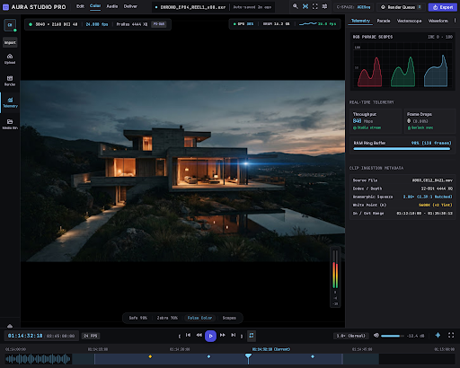
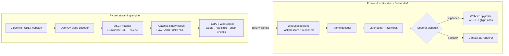

<div align="center">

# ⚡ ASCILINE

### Real-Time Video-to-ASCII & Pixel Streaming Engine

Turn video into a live ASCII or colored-pixel stream, delivered over binary WebSockets and rendered in the browser with WebGPU or a Canvas 2D fallback.

<p>
  <a href="#workstation-preview"><strong>Workstation</strong></a> ·
  <a href="#features"><strong>Features</strong></a> ·
  <a href="#architecture"><strong>Architecture</strong></a> ·
  <a href="#rendering-modes"><strong>Rendering modes</strong></a> ·
  <a href="#quick-start"><strong>Quick start</strong></a> ·
  <a href="#cli-reference"><strong>CLI reference</strong></a>
</p>

[](https://github.com/kushal98457-ctrl/ASCILINE/actions/workflows/ci.yml)
[](#quick-start)
[](https://fastapi.tiangolo.com/)
[](#rendering-modes)
[](LICENSE)

</div>

---

## What is ASCILINE?

ASCILINE is a video-processing and streaming workstation built around a Python server and a browser-based renderer. The server decodes video, maps image luminance to a character or pixel grid, and sends frames through a compact binary WebSocket protocol. The frontend decodes the stream and draws it using **WebGPU when available**, with **Canvas 2D as a fallback**.

Use it to experiment with real-time ASCII art, colored block-pixel rendering, video playback, stream telemetry, and compression strategies from one interface.

## Workstation preview

<div align="center">
  
  <sub>ASCILINE's browser-based workstation for playback, rendering controls, and stream telemetry.</sub>
</div>

### Source video vs. ASCILINE output

<div align="center">
  <table>
    <tr>
      <th align="center">Source media</th>
      <th align="center">ASCILINE · ASCII mode 4</th>
    </tr>
    <tr>
      <td width="50%"></td>
      <td width="50%"></td>
    </tr>
  </table>
</div>

## Features

| Area | What it does |
|---|---|
| **Real-time streaming** | Sends frames over binary WebSockets for low-overhead delivery to the browser renderer. The intended operating range is 24–60 FPS, depending on media, hardware, resolution, and network conditions. |
| **ASCII and pixel rendering** | Switch between character-based ASCII output and dense colored block pixels. |
| **Six color-depth modes** | Choose from monochrome output through 24-bit true color. |
| **Adaptive wire codec** | Supports raw frames, ZLIB, temporal-delta encoding, and DCT-based compression paths. |
| **Flow control** | Tracks client backlog, uses bounded buffering, and can shed frames when the stream is congested. |
| **Workstation controls** | Adjust contrast, gamma, inversion, character palettes, playback, and rendering options. |
| **Stream telemetry** | Inspect FPS, RAW versus WIRE bandwidth, jitter-buffer depth, and decode latency. |
| **Media sources** | Work with local video files, JSON playlists, URLs, and a connected webcam. |
| **Seek previews** | Generate on-demand thumbnail sprites for the playback scrubber; thumbnail generation can be disabled. |
| **Server safeguards** | Includes upload quota controls, rate limiting, origin validation, and a configurable client limit. |
| **Container support** | Includes Docker and Docker Compose configuration for a containerized deployment. |

### Workstation controls

- **Navigation rail** — Move between the media library, rendering settings, stream metrics, and filters.
- **Browser uploads** — Drag and drop local media into the server when uploads are enabled.
- **Live image controls** — Tune contrast, gamma, inversion, and character palettes during playback.
- **Telemetry HUD** — Monitor stream and rendering performance while a video is playing.
- **Interactive scrubber** — Seek through media with optional thumbnail previews.

## Architecture

ASCILINE separates video processing from presentation. The Python service handles media decoding, frame mapping, and packet encoding. The browser handles packet decoding, buffering, and rendering.



### Processing pipeline

1. **Ingest** — Read a video file, URL, playlist item, or webcam stream.
2. **Decode and map** — Decode frames and transform them into an ASCII or pixel representation.
3. **Encode** — Package frame data using the selected wire-codec path.
4. **Transport** — Deliver binary frames through FastAPI WebSockets with connection and upload safeguards.
5. **Buffer and render** — Decode frames in the browser, manage playback backlog, and render through WebGPU or Canvas 2D.

## Rendering modes

Choose a mode to control the available color depth.

| Mode | Color depth | Palette | Best for |
|:---:|---|---:|---|
| `1` | 1-bit | Monochrome | Classic terminal-style ASCII |
| `2` | 6-bit | 64 colors | Retro, limited-palette output |
| `3` | 9-bit | 512 colors | Stylized color with reduced palette size |
| `4` | 15-bit | 32,768 colors | Detailed color reproduction for everyday playback |
| `5` | 18-bit | 262,144 colors | Smoother gradients and tonal transitions |
| `6` | 24-bit | 16.7 million colors | Full RGB true-color output |

### Pixel mode

Pass `--pixel` to render the stream as dense colored block pixels (`█`) instead of ASCII characters. Pixel mode uses a higher default grid width than text mode.

## Quick start

### 1. Prerequisites

- Python **3.9 or newer**; Python 3.11+ is recommended.
- **FFmpeg and FFprobe** installed and available on your system `PATH`.
- A modern browser with WebGPU support for GPU rendering. Canvas 2D is available as a fallback.

### 2. Clone and install

```bash
git clone https://github.com/kushal98457-ctrl/ASCILINE.git
cd ASCILINE

python -m venv .venv
```

Activate the virtual environment, then install the dependencies.

**Windows PowerShell**

```powershell
.venv\Scripts\Activate.ps1
python -m pip install --upgrade pip
pip install -r requirements.txt
```

**Linux / macOS**

```bash
source .venv/bin/activate
python -m pip install --upgrade pip
pip install -r requirements.txt
```

Optional developer and test dependencies:

```bash
pip install -r requirements-dev.txt
```

### 3. Start the server

Start in the default sample or upload-ready mode:

```bash
python stream_server.py
```

Or start with a specific video and set the text-grid width:

```bash
python stream_server.py path/to/video.mp4 --cols 240
```

Open **http://127.0.0.1:8000** in your browser.

> **Network note:** The server binds to `127.0.0.1` by default. Review the upload and origin settings before exposing it to a LAN or the public internet.

## Frontend V2 development

The next-generation browser workstation is in `frontend-v2/`.

```bash
cd frontend-v2
npm ci
npm run dev
```

Run frontend checks and build the production bundle:

```bash
npm run typecheck
npm test
npm run build
```

The production build is written to `frontend-v2/dist` and is served by `stream_server.py`.

## CLI reference

```bash
python stream_server.py [options] [video]
```

### Source options

| Argument | Description |
|---|---|
| `video` | Video file path or URL. The default is `video.mp4` or upload-ready mode. |
| `--playlist FILE` | Load a JSON playlist. |
| `--folder DIR` | Stream videos in a folder, in filesystem order. |
| `--webcam` | Stream from a connected webcam. |
| `--webcam-device N` | Select the webcam device index. Default: `0`. |

### Rendering options

| Argument | Description |
|---|---|
| `--mode {1,2,3,4,5,6}` | Set the color-depth mode. Default: `1`. |
| `--pixel` | Enable colored block-pixel rendering. |
| `--cols N` | Set grid columns. Default: `200` for text and `450` for pixel mode. |
| `--rows N` | Set grid rows. Default: `0`, which enables automatic aspect-ratio calculation. |

### Playback and compression

| Argument | Description |
|---|---|
| `--quality {lossless,high,balanced,low}` | Select codec quality. Lossless is intended to preserve bit-exact fidelity; lower settings prioritize bandwidth reduction. |
| `--loop` | Loop the video or playlist. |
| `--vol {0,1,2,3,4,5}` | Set the audio volume multiplier. `0` mutes; `1` is normal volume. |
| `--no-thumbnails` | Disable seek-bar thumbnail generation. |

### Server and security

| Argument | Description |
|---|---|
| `--host IP` | Set the bind address. Default: `127.0.0.1`; use `0.0.0.0` for LAN or container access. |
| `--port PORT` | Set the server port. Default: `8000`. |
| `--max-clients N` | Set the maximum concurrent WebSocket connections. The server returns close code `1013` when saturated. |
| `--allow-upload` / `--no-allow-upload` | Enable or disable browser uploads. The default depends on whether the server is bound to loopback or a public interface. |
| `--allow-no-origin` / `--no-allow-no-origin` | Allow or reject WebSocket connections without an `Origin` header. The default depends on the bind interface. |
| `--debug` | Print RAW versus WIRE bandwidth statistics to the console. |

## Docker

Run ASCILINE with Docker Compose:

```bash
docker compose up --build
```

Or build and run the image directly:

```bash
docker build -t asciline .
docker run -p 8000:8000 -v "${PWD}/videos:/app/videos" asciline
```

The container configuration includes FFmpeg and OpenCV and is designed to run as a non-root user. Check the Docker files in the repository for the exact runtime configuration.

## Testing and verification

Run the Python test suite:

```bash
pytest -v
```

Run frontend tests:

```bash
cd frontend-v2
npm test
```

Verify the binary wire-codec test vectors:

```bash
python experiments/gen_vectors.py test_vectors.bin
node experiments/check_vectors.js test_vectors.bin
```

See [`test/README.md`](test/README.md) for details about test runners and fixtures.

## Key project paths

| Path | Purpose |
|---|---|
| `stream_server.py` | Python streaming server and command-line entry point |
| `frontend-v2/` | Browser workstation frontend |
| `frontend-v2/dist/` | Production frontend build output |
| `assets/` | README screenshots and demo media images |
| `experiments/` | Wire-codec vector generation and verification scripts |
| `test/` | Test documentation and fixtures |

## Credits

- **Original concept and implementation:** [YusufB5](https://github.com/YusufB5) · [YusufB5/ASCILINE](https://github.com/YusufB5/ASCILINE)
- **Frontend V2, CI, and subsequent enhancements:** [Kushal](https://github.com/kushal98457-ctrl) — WebGPU workstation, CI test automation, upload quota management, server hardening, and streaming optimizations.

## License

See [`LICENSE`](LICENSE) for the full terms. The repository describes the license as **MIT with an anti-advertisement restriction**; review the license file for the precise conditions.
